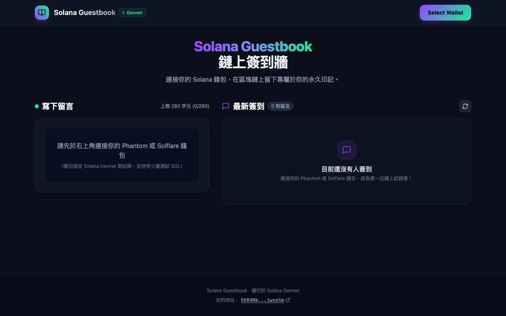

# Solana Guestbook · 鏈上留言簽到牆

> **Web3 Edge Fullstack Application**：結合 Solana 區塊鏈智能合約、Cloudflare Workers Rust Wasm 邊緣計算、Cloudflare D1 邊緣 SQLite 與 React 18 的現代化 CQRS 讀寫分離全端專案。



---

## 核心架構亮點

> **系統架構深度解析**：欲深入了解完整的 CQRS 流程圖、Solana Sealevel vs EVM 無鎖並行設計、D1 邊緣快取邏輯，請參閱 [`docs/ARCHITECTURE.md`](./docs/ARCHITECTURE.md)。

1. **CQRS 讀寫分離架構**：
   - **寫入鏈上 (Write Path)**：用戶透過 Phantom 或 Solflare 錢包直接對 Solana Devnet 智能合約簽署交易，時間戳與資料存於鏈上，保障去中心化與防篡改。
   - **邊緣讀取 (Read Path)**：透過 Cloudflare Workers (Rust / Wasm) 與 Cloudflare D1 (邊緣 SQLite) 進行全表快取，提供低於 20ms 的全球讀取體驗，避免直接呼叫 Solana 公開 RPC 遭遇嚴格的 Rate Limit (429 錯誤)。
2. **一人一 PDA（無鎖並行設計）**：
   - 智能合約採用 `[b"checkin", user.key().as_ref()]` 衍生地址（PDA），不同用戶簽到寫入獨立的存儲帳戶，充分發揮 Solana Sealevel 引擎的多核心硬體平行處理優勢。
3. **極致輕量邊緣後端**：
   - 邊緣後端以純 Rust 撰寫並編譯為 WebAssembly (Wasm)，二進位檔案體積僅 **22.5 KB**，冷啟動延遲低至個位數毫秒。
4. **現代化前端與簡約美學**：
   - 基於 React 18 + Vite 6 + TailwindCSS，支援官方 Solana Wallet Standard 動態錢包偵測。

---

## 技術棧 (Tech Stack)

| 模組           | 技術選型                             | 說明                                                                  |
| :------------- | :----------------------------------- | :-------------------------------------------------------------------- |
| **智能合約**   | **Solana / Anchor (Rust)**           | 部署於 Solana Devnet (`EKR4NkE7RYZiLynvP4LWEq6UNcbfKnKiJkq72ciwxoSm`) |
| **邊緣運算**   | **Cloudflare Workers (Rust / Wasm)** | 透過 `worker-build` 編譯為 22.5KB Wasm                                |
| **邊緣資料庫** | **Cloudflare D1 (SQLite @ Edge)**    | 邊緣分散式 SQL 資料庫，UPSERT 冪等性維護                              |
| **前端應用**   | **React 18 + Vite 6 + TailwindCSS**  | 支援 Solana Wallet Standard，遵循極簡社群流介面設計                   |
| **套件管理**   | **pnpm (v9 Monorepo)**               | 硬連結 (Hard-link) 機制，防範幽靈依賴並大幅節省磁碟空間               |

---

## 本地開發快速開始 (Local Development)

### 1. 前置環境準備

確保本機已安裝以下工具：

- **Node.js**: v20+ 或 v22+
- **pnpm**: v9+ (`npm install -g pnpm`)
- **Rust Toolchain**: `rustup` 與 `cargo` (`curl --proto '=https' --tlsv1.2 -sSf https://sh.rustup.rs | sh`)
- **Wasm 工具**: `cargo install -q worker-build wasm-pack`

### 2. 安裝專案依賴

在專案根目錄執行：

```bash
pnpm install
```

### 3. 初始化本地邊緣資料庫 (Cloudflare D1)

本地開發會使用 Wrangler 內建的輕量運行時（Miniflare）在本地模擬 SQLite，無需設定 Cloudflare 雲端帳號即可離線開發：

```bash
pnpm run worker:init-d1
```

### 4. 啟動後端邊緣服務 (Worker)

在一個終端機視窗執行：

```bash
pnpm run worker:dev
```

- 後端服務將監聽在 `http://localhost:8787`。
- 支援程式碼變更熱重載 (Hot Reload)。

### 5. 啟動前端介面 (Frontend)

在另一個終端機視窗執行：

```bash
pnpm run dev:frontend
```

- 開發伺服器將監聽在 `http://localhost:5173`。
- 打開瀏覽器即可連接 Phantom、Solflare 等錢包進行測試！

---

## 自動化測試 (Testing)

專案包含完整的 Rust 單元測試、邊緣 API 端到端 (E2E) 測試與前端生產打包驗證：

### 1. Rust 原生單元測試 (合約驗證與安全邊界)

測試 Base58 解碼、32 位元組公鑰校驗、64 位元組交易簽名格式及字串長度防禦：

```bash
pnpm run test:rust
```

> 輸出範例：`test result: ok. 5 passed; 0 failed; 0 ignored; 0 measured; 0 filtered out; finished in 0.00s`

### 2. 邊緣 API 整合測試 (E2E Integration Test)

測試 CORS 預檢、D1 資料庫讀寫、UPSERT 冪等性與異常資料攔截（共 10 項嚴格測試）：

```bash
pnpm run test:worker
```

> 輸出範例：`10 passing (1.8s)`

### 3. 前端靜態類型與生產打包檢查

驗證 TypeScript 類型安全與 Vite Rollup 打包完整性：

```bash
pnpm run build:frontend
```

---

## 磁碟空間釋放 (Disk Space Management)

### 為什麼 Rust 開發會佔用硬碟空間？

Rust 在編譯時為了達到極致的運行效能與快速增量編譯，會在 `worker/target/` 產生大量 LLVM IR、中間物件檔（`.o`）、單態化泛型實體與除錯符號（DWARF）。本專案的 `worker/target/` 通常會佔用約 **900MB ~ 1GB** 的快取。

### 一鍵釋放硬碟空間

當你完成開發想要回收筆電磁碟空間時，直接在根目錄執行：

```bash
pnpm run clean:rust
```

_(或手動執行 `cd worker && cargo clean`)_

- 此指令會安全刪除 `worker/target/` 編譯暫存目錄，**瞬間釋放約 950 MB+ 空間**。
- 下次啟動 `pnpm run worker:dev` 時，編譯器會自動重新下載並編譯所需相依套件。

若想同時清理前端與 Node.js 依賴：

```bash
# 刪除所有 node_modules
rm -rf node_modules frontend/node_modules
# 需要時再透過 pnpm install 快速重建
```

---

## 後端 API 規格與 Scalar 文件

邊緣後端提供標準的 RESTful API，並符合 **OpenAPI 3.0** 規範：

- **OpenAPI 規格檔**：位於 [`docs/openapi.yaml`](./docs/openapi.yaml)

### 如何檢視與測試 API？(支援 Scalar 與 Swagger)

1. **[Scalar (https://scalar.com)](https://scalar.com)**：
   - 前往 [Scalar Sandbox](https://sandbox.scalar.com) 貼上專案的 `docs/openapi.yaml`。
2. **API 測試客戶端匯入**：
   - 規格檔可一鍵直接匯入至 **Postman**、**Insomnia** 或 **VS Code OpenAPI Extension**。

### API 端點簡述

#### 1. 取得最新簽到列表

- **URL**: `GET /api/checkins`
- **說明**: 取得前 50 筆最新簽到記錄（依時間戳倒序排序）。
- **回應範例**:
  ```json
  {
    "success": true,
    "data": [
      {
        "user_pubkey": "EKR4NkE7RYZiLynvP4LWEq6UNcbfKnKiJkq72ciwxoSm",
        "message": "Hello Solana World!",
        "timestamp": 1792837773,
        "tx_signature": "4VERv8NMvzbJMEkV8xnrLkEaWRtSz9CosKDYj7WNXTHQXUrJhUCP5vwWcxWDN45x1T8YshbWwM5jP5ZJb25i58tB"
      }
    ],
    "error": null
  }
  ```

#### 2. 同步鏈上簽到至邊緣資料庫

- **URL**: `POST /api/checkin`
- **Payload**:
  ```json
  {
    "userPubkey": "EKR4NkE7RYZiLynvP4LWEq6UNcbfKnKiJkq72ciwxoSm",
    "message": "Hello Solana World!",
    "txSignature": "4VERv8NMvzbJMEkV8xnrLkEaWRtSz9CosKDYj7WNXTHQXUrJhUCP5vwWcxWDN45x1T8YshbWwM5jP5ZJb25i58tB"
  }
  ```

---

## 專案結構 (Directory Structure)

```text
solana-guestbook/
├── programs/
│   └── guestbook/             # Solana Anchor (Rust) 智能合約原始碼
├── worker/                    # Cloudflare Workers (Rust / Wasm) 邊緣服務
│   ├── src/
│   │   ├── lib.rs             # HTTP 路由、CORS 與主邏輯
│   │   ├── db.rs              # Cloudflare D1 (SQLite) 讀寫與 UPSERT
│   │   └── verify.rs          # Base58、公鑰與簽名長度防禦校驗
│   ├── schema.sql             # D1 資料表綱要
│   └── Cargo.toml             # Rust 相依套件與 worker-build 配置
├── frontend/                  # 前端 React 應用程式
│   ├── src/
│   │   ├── components/        # Navbar, CheckInForm, GuestbookWall
│   │   ├── idl.json           # Solana 合約介面定義 (IDL)
│   │   └── App.tsx            # 主介面與錢包 Context 整合
│   └── vite.config.ts         # Vite 打包配置與 Web3 ESM/CJS Shim
├── scripts/
│   └── test-worker.mjs        # 原生 Node.js ESM 端到端 (E2E) 測試套件
├── docs/                      # 架構與規格說明文件
│   ├── ARCHITECTURE.md        # 系統架構深度解析 (CQRS / PDA / D1)
│   ├── openapi.yaml           # OpenAPI 3.0 規格檔
│   └── images/                # 介面與架構圖檔
├── idl.json                   # 根目錄合約 IDL 副本
└── package.json               # 專案 Monorepo 工作區與指令設定
```

---

## 鏈上部署資訊 (Solana Devnet)

- **Network**: `Solana Devnet`
- **Program ID**: [`EKR4NkE7RYZiLynvP4LWEq6UNcbfKnKiJkq72ciwxoSm`](https://explorer.solana.com/address/EKR4NkE7RYZiLynvP4LWEq6UNcbfKnKiJkq72ciwxoSm?cluster=devnet)
- **PDA Seeds**: `[b"checkin", user_pubkey.as_ref()]`
- **Anchor IDL**: 根目錄 [`idl.json`](./idl.json)
