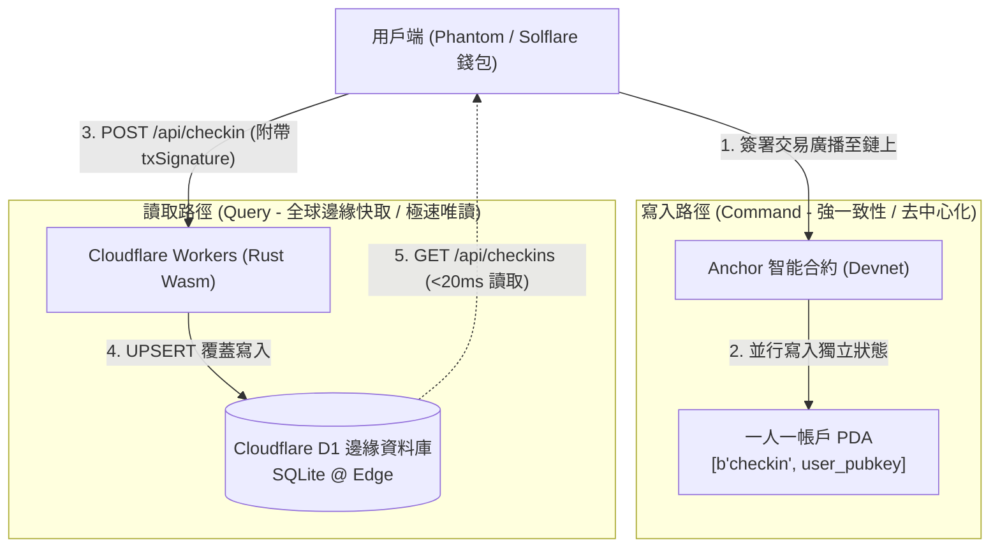

# Solana Guestbook 全端架構深度解析 (Architecture & System Design)

---

## 一、 介面預覽與全貌


---

## 二、 核心架構設計：CQRS 讀寫分離

傳統 Web3 DApp 面臨的痛點是：**Solana 寫入極快，但直接讀取極慢且昂貴**。
如果前端使用 `getProgramAccounts` 向免費公共 RPC 節點全表掃描留言，會遭遇嚴重的 Rate Limit（每秒上限常僅個位數或直接拋出 429 Too Many Requests）。

為此，本專案採用 **CQRS（Command Query Responsibility Segregation，命令查詢職責分離）** 邊緣架構：



### 1. 寫入路徑 (Write Path)

- **直接上鏈**：用戶透過 Phantom / Solflare 錢包直接與 Solana Devnet 上的 Anchor 合約交互。
- **不可否認性**：資料與時間戳權威儲存於鏈上，保障去中心化與防篡改。

### 2. 讀取路徑 (Read Path)

- **邊緣快取**：由 Cloudflare Workers (Rust / Wasm) 與 Cloudflare D1 (邊緣 SQLite) 負責全表讀取。
- **全球加速**：全球 300+ 邊緣節點提供低於 20ms 的讀取延遲，大幅降低 RPC 成本並支撐百萬併發。

---

## 三、 Solana 鏈上合約：一人一 PDA 無鎖並行

- **Program ID**：`EKR4NkE7RYZiLynvP4LWEq6UNcbfKnKiJkq72ciwxoSm`
- **種子公式 (Seeds)**：
  ```rust
  seeds = [b"checkin", user.key().as_ref()]
  ```

### 為什麼不設計「全域簽到陣列」？

1. **以太坊模式的瓶頸**：若合約內部維護全域 `Vec<CheckIn>`，所有用戶簽到都在爭搶修改同一個帳戶狀態，交易被迫排隊等待鎖釋放（Lock Contention）。
2. **Solana Sealevel 引擎優勢**：透過讓每個用戶擁有專屬的 PDA 帳戶，Alice 簽到寫入 A 帳戶，Bob 簽到寫入 B 帳戶，彼此帳戶完全獨立無交集。Solana 節點排程器即可排定兩者在**不同的硬體 CPU/GPU 核心並行執行**，實現每秒千筆的高吞吐量。

---

## 四、 邊緣後端：Rust Wasm + Cloudflare D1

### 1. 技術棧選型

- **運行時**：Cloudflare Workers (基於 V8 沙盒的 Wasm 執行環境)。
- **程式語言**：純 Rust（透過 `worker-build --release` 編譯為 22.5 KB 的微型 Wasm 二進位檔）。
- **資料庫**：Cloudflare D1（邊緣分散式 SQLite）。

### 2. 資料表結構 (Schema)

```sql
CREATE TABLE IF NOT EXISTS checkins (
    user_pubkey TEXT PRIMARY KEY,
    message TEXT NOT NULL,
    timestamp INTEGER NOT NULL,
    tx_signature TEXT NOT NULL
);

CREATE INDEX IF NOT EXISTS idx_checkins_timestamp
ON checkins (timestamp DESC);
```

### 3. 一人一筆記錄的 UPSERT 冪等性

同一用戶若重複簽到，D1 會以 `UPSERT` 語義覆蓋舊記錄，確保簽到牆永遠展示每位用戶的最新動態，且總記錄筆數不會無限制膨脹：

```sql
INSERT INTO checkins (user_pubkey, message, timestamp, tx_signature)
VALUES (?1, ?2, ?3, ?4)
ON CONFLICT(user_pubkey) DO UPDATE SET
    message = excluded.message,
    timestamp = excluded.timestamp,
    tx_signature = excluded.tx_signature;
```

---

## 五、 API 規格說明

### 1. 取得最新簽到列表

- **Endpoint**: `GET /api/checkins`
- **Response**:
  ```json
  {
    "success": true,
    "data": [
      {
        "user_pubkey": "EKR4NkE7RYZiLynvP4LWEq6UNcbfKnKiJkq72ciwxoSm",
        "message": "Hello Solana World!",
        "timestamp": 1792837773,
        "tx_signature": "4VERv8NMvzbJMEkV8xnrLkEaWRtSz9CosKDYj7WNXTHQXUrJhUCP5vwWcxWDN45x1T8YshbWwM5jP5ZJb25i58tB"
      }
    ],
    "error": null
  }
  ```

### 2. 同步鏈上簽到至邊緣快取

- **Endpoint**: `POST /api/checkin`
- **Request Body**:
  ```json
  {
    "userPubkey": "EKR4NkE7RYZiLynvP4LWEq6UNcbfKnKiJkq72ciwxoSm",
    "message": "Hello Solana World!",
    "txSignature": "4VERv8NMvzbJMEkV8xnrLkEaWRtSz9CosKDYj7WNXTHQXUrJhUCP5vwWcxWDN45x1T8YshbWwM5jP5ZJb25i58tB"
  }
  ```
- **邊緣防禦校驗**：
  - 驗證 `userPubkey` 是否為合法 Base58 編碼且解碼長度為 32 位元組。
  - 驗證 `txSignature` 是否為合法 Base58 編碼且解碼長度為 64 位元組。
  - 驗證 `message` 不得為空且長度小於 280 字元。
